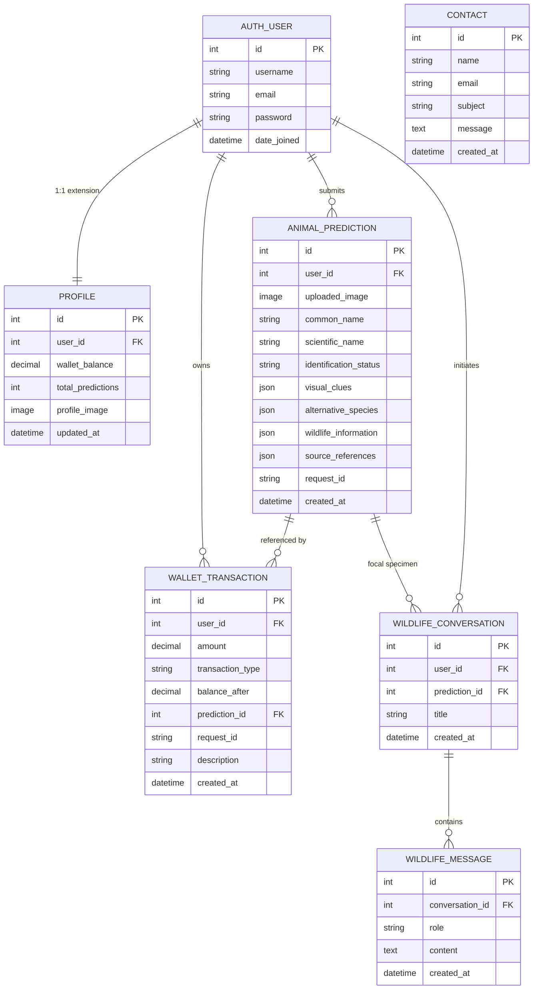

# WildLensAI — Database Design & Schema Documentation

**WildLensAI** utilizes a serverless, file-based **SQLite 3** relational database managed exclusively through the **Django Object-Relational Mapper (ORM)** and schema migration framework. This design delivers zero-configuration, self-contained deployment for local development and B.Tech college viva demonstration, while enforcing strict relational integrity, data privacy, and concurrency safety.

---

## 1. Architectural Justification: Why SQLite?

1. **Academic Demonstration & Zero-DevOps:** College project evaluation occurs locally on examiner laptops or classroom projectors. Requiring PostgreSQL, Docker, or Redis introduces needless installation barriers and connection latency. SQLite operates out of a single file (`db.sqlite3`).
2. **ACID Relational Compliance:** SQLite is fully ACID-compliant. By pairing `transaction.atomic()` with conditional Django `F` expressions, balance deductions and ledger entries are atomic and race-condition free.
3. **Decoupled Workloads:** Network-bound API invocations (Gemini and LangGraph) run completely **outside** database transaction blocks, ensuring SQLite write locks are held only for sub-millisecond table writes.

---

## 2. Entity-Relationship (ER) Diagram



---

## 3. Data Models Specification

### A. Authentication & User Profile (`transactions.models`)

#### 1. `Profile`
One-to-one extension of Django's `auth.models.User`.
- `user`: `OneToOneField(User, on_delete=CASCADE, related_name="profile")`
- `wallet_balance`: `DecimalField(max_digits=10, decimal_places=2, default=5.00)`
- `total_predictions`: `PositiveIntegerField(default=0)`
- `profile_image`: `ImageField(upload_to="profile_images/", blank=True, null=True)`
- `updated_at`: `DateTimeField(auto_now=True)`

*Lifecycle Hook:* A Django `post_save` receiver on `User` automatically creates a `Profile` with ₹5.00 demo balance and writes the initial `signup_bonus` transaction.

#### 2. `WalletTransaction`
Immutable financial audit ledger tracking every demo credit movement.
- `user`: `ForeignKey(User, on_delete=CASCADE, related_name="wallet_transactions")`
- `amount`: `DecimalField(max_digits=10, decimal_places=2)` — Signed value (+5.00, -1.00)
- `transaction_type`: `CharField(choices=[signup_bonus, prediction_charge, admin_grant, refund, demo_recharge])`
- `balance_after`: `DecimalField(max_digits=10, decimal_places=2)`
- `prediction`: `ForeignKey(AnimalPrediction, null=True, blank=True, on_delete=SET_NULL)`
- `request_id`: `CharField(max_length=64, blank=True, null=True, db_index=True)`
- `description`: `CharField(max_length=255)`
- `created_at`: `DateTimeField(auto_now_add=True, db_index=True)`

---

### B. Wildlife Intelligence Models (`animal.models`)

#### 3. `AnimalPrediction`
Stores visual identification findings, morphology, and verified external intelligence.
- `user`: `ForeignKey(User, on_delete=SET_NULL, null=True, blank=True)` — Enforces data isolation
- `uploaded_image`: `ImageField(upload_to="uploads/")`
- `common_name`: `CharField(max_length=150)`
- `scientific_name`: `CharField(max_length=150, blank=True, null=True)`
- `confidence`: `FloatField(default=0.0)`
- `credit_used`: `FloatField(default=1.0)`
- `identification_status`: `CharField(max_length=30, choices=[identified, uncertain, not_animal])`
- `identification_notes`: `TextField(blank=True)`
- `visual_clues`: `JSONField(default=list, blank=True)`
- `alternative_species`: `JSONField(default=list, blank=True)`
- `wildlife_information`: `JSONField(default=dict, blank=True)`
- `source_references`: `JSONField(default=list, blank=True)`
- `request_id`: `CharField(max_length=64, unique=True, null=True, blank=True, db_index=True)`
- `created_at`: `DateTimeField(auto_now_add=True, db_index=True)`

#### 4. `WildlifeConversation`
Container for multi-turn dialogue grounded in a specific identified animal.
- `user`: `ForeignKey(User, on_delete=CASCADE, related_name="wildlife_conversations")`
- `prediction`: `ForeignKey(AnimalPrediction, on_delete=CASCADE, related_name="conversations")`
- `title`: `CharField(max_length=200, default="Wildlife Inquiry")`
- `created_at`: `DateTimeField(auto_now_add=True)`
- `updated_at`: `DateTimeField(auto_now=True)`

#### 5. `WildlifeMessage`
Individual messages within a conversation.
- `conversation`: `ForeignKey(WildlifeConversation, on_delete=CASCADE, related_name="messages")`
- `role`: `CharField(max_length=20, choices=[user, assistant, system])`
- `content`: `TextField()`
- `created_at`: `DateTimeField(auto_now_add=True)`

#### 6. `Contact`
General contact, inquiry, and feedback messages.
- `name`: `CharField(max_length=100)`
- `email`: `EmailField()`
- `subject`: `CharField(max_length=200)`
- `message`: `TextField()`
- `created_at`: `DateTimeField(auto_now_add=True)`

---

## 4. Concurrency Safety & Idempotency in SQLite

### A. Preventing Negative Balances Without Row Locks
SQLite lacks row-level `SELECT ... FOR UPDATE` locking. WildLensAI guarantees concurrency safety using atomic conditional SQL updates via Django `F` expressions:

```python
updated = Profile.objects.filter(
    id=profile.id,
    wallet_balance__gte=cost
).update(
    wallet_balance=F("wallet_balance") - cost,
    total_predictions=F("total_predictions") + 1
)
if updated == 0:
    raise InsufficientFundsError("Insufficient wallet credits.")
```
If two concurrent identification requests execute simultaneously for a user with only 1 credit:
1. SQLite serializes the table write.
2. The first request decrements the balance from 1.00 to 0.00 (`updated == 1`).
3. The second request tests `wallet_balance__gte=1.00`, which evaluates to false (`updated == 0`), rejecting the charge cleanly.

### B. Request Idempotency
- When an upload form renders, a unique `request_id` (UUIDv4) is generated.
- On POST submission, `AnimalPrediction.objects.filter(user=request.user, request_id=request_id).first()` is checked.
- If a resubmission occurs (e.g. browser refresh or network retry), the existing result is returned immediately without deducting additional credits or triggering external API calls.

---

## 5. Migration History

| App | Migration | Description |
| :--- | :--- | :--- |
| `animal` | `0001_initial.py` | Initial `AnimalPrediction` schema. |
| `animal` | `0002_contact.py` | Added `Contact` model for user feedback. |
| `animal` | `0003_animalprediction_user_and_more.py` | Linked predictions to `User` and added conversation models. |
| `animal` | `0004_alter_animalprediction_options_...` | Added JSON fields for visual clues, alternative species, and references. |
| `animal` | `0005_animalprediction_request_id.py` | Added unique indexed `request_id` for idempotency. |
| `transactions` | `0001_initial.py` | Initial `Profile` model with demo credits. |
| `transactions` | `0002_alter_profile_options_wallettransaction.py` | Added `WalletTransaction` audit ledger and admin actions. |

