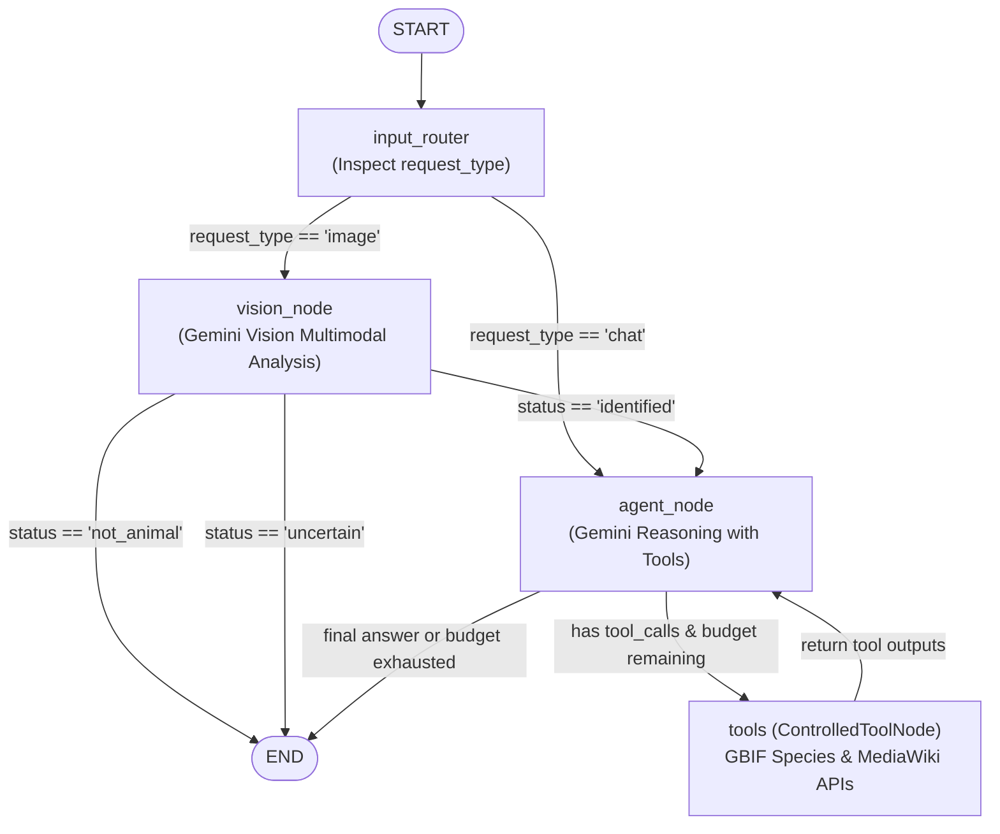

# WildLensAI — LangGraph Wildlife Agent Architecture

**Framework:** LangGraph `StateGraph`  
**Model:** `ChatGoogleGenerativeAI` (`langchain-google-genai`)  
**Tools:** `ControlledToolNode` (subclass of LangGraph `ToolNode`)  
**Persistent Relational Memory:** Django ORM & SQLite  
**Author:** Senior Python Developer, Django Architect, and LangGraph AI Engineer  
**Date:** October 2026  
**Status:** Phase 4 Complete  

---

## 1. Architectural Overview & Graph Topology

WildLensAI implements a genuine, lightweight **LangGraph `StateGraph`** agent designed for autonomous wildlife identification, taxonomic verification, and conversational inquiry.

The graph operates without monolithic `create_react_agent` wrappers, external agent frameworks (CrewAI, AutoGen), vector databases (ChromaDB, Pinecone, FAISS), Redis, or Celery. It maintains strict local execution with SQLite persistence.

### Graph Flowchart



---

## 2. Graph Nodes Breakdown

### A. `input_router`
- **Purpose:** Initializes baseline execution metadata and routes incoming payloads.
- **Inputs:** `WildlifeAgentState`.
- **Output:** Baseline dictionary setting default counters (`tool_call_count=0`, `iteration_count=0`).
- **Edge:** Conditional edge `route_request`.

### B. `vision_node`
- **Purpose:** Executes Gemini Multimodal Vision analysis on uploaded images using Pillow-validated bytes passed via `config["configurable"]`.
- **Logic:**
  1. Retrieves `image_bytes` and `mime_type` from runtime configuration.
  2. Invokes `identify_animal_from_image(...)` from the Phase 3 service layer.
  3. Evaluates qualitative status:
     - **`not_animal`:** Constructs immediate structured result stating no animal detected and routes to `END`.
     - **`uncertain`:** Records ambiguous silhouette / visual clues with potential candidate species and routes to `END`.
     - **`identified`:** Creates an initial observation prompt containing common name, scientific name, and visual clues, routing into `agent_node`.
- **Edge:** Conditional edge `route_vision`.

### C. `agent_node`
- **Purpose:** Central autonomous reasoning engine. Decides whether to query taxonomy (GBIF) or wildlife biology (MediaWiki).
- **Tool Binding:** Uses Gemini's native function calling (`model.bind_tools(APPROVED_TOOLS)`).
- **Execution Budget Guard:**
  - If `tool_call_count >= 3` or `iteration_count >= 4`, the model is invoked **without tools bound**, forcing an immediate final text response.
  - When a final text response is produced, it scans all `ToolMessage`s in history to compile verified `source_references` with authoritative URLs.
- **Edge:** Conditional edge `should_continue`.

### D. `tools` (`ControlledToolNode`)
- **Purpose:** LangGraph `ToolNode` subclass executing approved read-only tools while enforcing strict safety boundaries.
- **Safety Features:**
  - Rejects unknown or unapproved tools with an explicit `ToolMessage(status='error')`.
  - Deduplicates requests by matching tool signatures (`name:args`), preventing wasteful repeated queries.
  - Caps total external tool executions at 3 per session.

---

## 3. Minimal State Schema (`WildlifeAgentState`)

```python
class WildlifeAgentState(TypedDict):
    messages: Annotated[list[AnyMessage], add_messages]
    request_type: Literal["image", "chat"]
    identification: Optional[dict[str, Any]]
    source_references: list[dict[str, str]]
    tool_call_count: int
    executed_tool_calls: list[str]
    iteration_count: int
    final_result: Optional[dict[str, Any]]
    error: Optional[str]
```

### State Hygiene Rules
- **No Image Binaries:** Raw image bytes are passed strictly via `config["configurable"]` and never stored in the persisted graph state.
- **No Credentials:** API keys remain strictly in environment variables.
- **No Django Models:** Only JSON-serializable primitives (dicts, lists, strings, ints) are stored in state.
- **Standard Reducer:** Relies on LangGraph's standard `add_messages` reducer to accumulate dialogue history.

---

## 4. Conditional Routing Logic

### 1. `route_request(state)`
- If `request_type == "image"`: routes to `vision_node`.
- If `request_type == "chat"`: routes directly to `agent_node`.

### 2. `route_vision(state)`
- If an error occurred or `identification_status` is `not_animal` or `uncertain`: routes directly to `END`.
- If `identification_status == "identified"`: routes to `agent_node` for deep taxonomy and facts lookup.

### 3. `should_continue(state)`
- If `iteration_count >= 5`: routes to `END` (infinite loop guard).
- If the last message is an `AIMessage` with `tool_calls` AND `tool_call_count < 3`: routes to `tools`.
- Otherwise: routes to `END`.

---

## 5. Approved Read-Only External Tools

| Tool Name | Service | Endpoint | Returned Data |
| :--- | :--- | :--- | :--- |
| `lookup_species_taxonomy` | GBIF Species API | `https://api.gbif.org/v1/species/match` | Scientific name, Kingdom, Phylum, Class, Order, Family, Genus, Species, Match status, Source URL |
| `get_wildlife_facts` | MediaWiki API | `https://en.wikipedia.org/w/api.php` | Educational summary, Article title, Source URL, Conservation status verification note |

### Tool Security & Reliability Guardrails
1. **Strict Allowlist:** Only HTTPS requests to `api.gbif.org` and `en.wikipedia.org` are allowed.
2. **Parameter Validation:** Species queries are stripped, length-capped (<= 150 characters), and regex-validated against injection attacks.
3. **HTTP Timeouts:** Strict 10.0-second timeout on all outbound requests via `httpx.Client`.
4. **Honest Conservation Policy:** Encyclopedia text is explicitly noted as not an independently verified conservation status unless confirmed by authoritative IUCN Red List records.

---

## 6. Why This Implementation Is True Agentic AI

Unlike simple prompt wrappers or rigid chain pipelines, WildLensAI exhibits genuine agentic characteristics:

1. **Autonomous Tool Selection:** The agent analyzes the user prompt and visual identification, independently determining whether it needs to query GBIF, MediaWiki, both, or neither.
2. **Multi-Turn Reflection & Tool Feedback Loop:** Tool outputs are fed directly back into the agent context (`tools -> agent_node`), enabling the model to inspect the retrieved data, evaluate gaps, and formulate reasoned responses.
3. **Dynamic Self-Limiting:** The agent operates within an explicit budget (max 3 tool calls, max 5 iterations). When limits are reached, it gracefully synthesizes an answer using available data rather than failing.
4. **Evidence Grounding:** Results link directly to authoritative sources, and the agent explicitly admits when information cannot be found.

---

## 7. Safety Limits & Controlled Execution

- **Tool Execution Cap:** Maximum 3 external HTTP tool calls per session.
- **Graph Iteration Cap:** Maximum 5 node iterations per session.
- **Recursion Limit Guard:** `recursion_limit=10` passed to all `app.invoke()` calls.
- **Duplicate Call Prevention:** Tracks executed call signatures (`name:args`) to reject identical queries.
- **Read-Only Scope:** Tools possess zero shell, filesystem, database write, or wallet manipulation capabilities.

---

## 8. Persistent Relational Memory via SQLite & Django ORM

WildLensAI avoids vector database overhead (ChromaDB, FAISS) by leveraging Django's native relational data models:

1. **Durable Conversation Storage:** `WildlifeConversation` and `WildlifeMessage` store multi-turn chat threads in SQLite.
2. **Bounded Context Window:** When a user sends an inquiry, the view retrieves the recent conversation history (bounded to the last 10 messages) and passes it into LangGraph as a clean list of `HumanMessage` and `AIMessage` objects.
3. **Data Isolation:** All predictions and conversations are strictly isolated by `request.user`. Users cannot access or interact with another user's wildlife conversations (enforced via 404 barrier).
