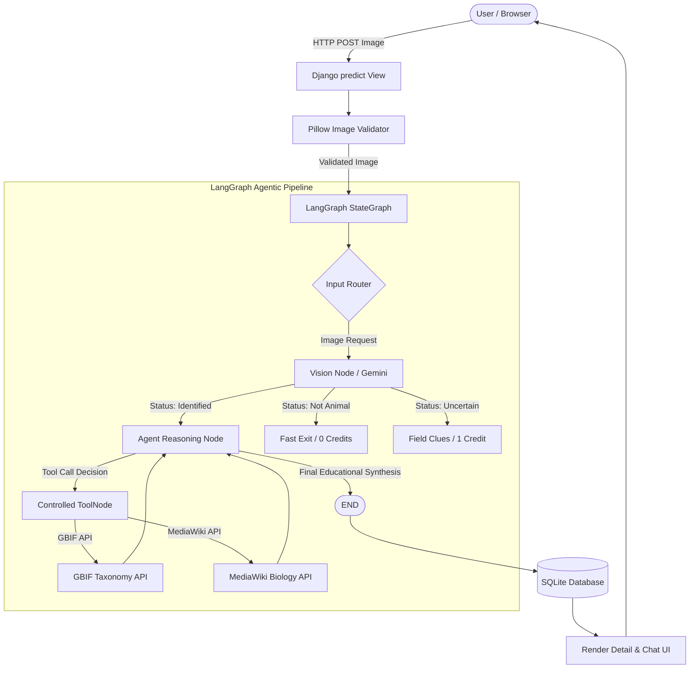

# WildLensAI — Project Architecture & System Design

**WildLensAI** is an AI-powered, agentic wildlife identification and educational platform engineered with **Django**, **SQLite**, **LangGraph**, and Google's **Gemini Vision** API. Designed specifically for reliable local execution and B.Tech academic evaluation, it bridges computer vision, structured reasoning, automated taxonomic verification, and conversational AI into a unified architecture without heavy distributed infrastructure.

---

## 1. System Overview & Core Philosophy

WildLensAI replaces fragile heuristic scripts and black-box classifiers with an agentic, evidence-grounded workflow:
1. **User Authenticates & Uploads:** The user submits a field photograph via a responsive Bootstrap 5 web interface.
2. **Deterministic Pre-Validation:** The upload is locally validated using **Pillow** (enforcing safe format, decompression bomb protection, size caps, and geometry checks).
3. **Multimodal Extraction:** The validated image is passed to **Gemini Vision** using Pydantic structured output, extracting observed visual clues, candidate species, and taxonomy.
4. **LangGraph StateGraph Orchestration:** An agentic state graph evaluates the diagnostic confidence. For identified specimens, it dynamically executes read-only tools against authoritative biological sources (**GBIF Species API** and **MediaWiki**).
5. **Persistent Context & Audit:** The classification, verified taxonomy, and ecological facts are recorded to an **SQLite** database, creating an interactive conversation session and debiting 1 demo credit atomically.
6. **Context-Aware Dialogue:** The user engages in multi-turn follow-up chat in English or Hindi, grounded strictly in the identified specimen's biological profile.



---

## 2. Technology Stack & Architectural Constraints

WildLensAI adheres strictly to lightweight, self-contained dependencies suitable for offline/local evaluation:

| Layer | Technology | Purpose & Justification |
| :--- | :--- | :--- |
| **Backend Framework** | **Django 5.1+ / Python 3.11+** | Monolithic MVC architecture; integrated authentication, ORM, admin site, and CSRF protection. |
| **Database** | **SQLite 3** | Zero-configuration, serverless, file-based relational database. Perfect for local college viva demonstrations. |
| **Frontend** | **Django Templates, Bootstrap 5, Bootstrap Icons** | Responsive UI with native HTML5/CSS3. Pinned Bootstrap Icons (`1.13.2`) with **zero decorative emojis**. |
| **Multimodal Vision** | **Google Gemini (`langchain-google-genai`)** | State-of-the-art vision reasoning via `ChatGoogleGenerativeAI` with Pydantic structured outputs. |
| **Agentic Framework** | **LangGraph (`StateGraph`)** | Cyclic agent graph enabling dynamic tool execution, state loops, and conditional branching. |
| **Image Processing** | **Pillow (PIL)** | Safe in-memory image verification, format checking, and decompression bomb prevention. |
| **HTTP Transport** | **HTTPX** | Resilient external API calls with timeouts and bounded connections. |

### Architectural Invariants:
- **No Redis / Celery:** All operations execute within Django's synchronous request/response cycle, keeping deployment simple.
- **No Vector Databases:** Semantic search vectors are unnecessary for specimen-grounded conversations; memory is directly persisted in SQLite.
- **No Heavy Client Frameworks:** Avoids Node.js, React, or npm build pipelines; pure server-rendered Django templates with lightweight vanilla JavaScript.

---

## 3. Directory Structure

```text
WildLensAI/
├── manage.py
├── requirements.txt
├── README.md
├── db.sqlite3
├── .env.example
│
├── WildLensAI/                  # Core Project Configuration
│   ├── __init__.py
│   ├── asgi.py
│   ├── settings.py              # Environment variables, apps, middleware
│   ├── urls.py                  # Root URL routing
│   └── wsgi.py
│
├── animal/                      # Wildlife Core Application
│   ├── agent/                   # LangGraph Agentic Subsystem
│   │   ├── __init__.py
│   │   ├── graph.py             # StateGraph definition, nodes, conditional edges
│   │   ├── state.py             # TypedDict WildlifeAgentState
│   │   └── tools.py             # ControlledToolNode, GBIF & MediaWiki tools
│   ├── migrations/              # Database migration history
│   ├── services/                # Reusable Service Layer
│   │   ├── __init__.py
│   │   ├── gemini_service.py    # Gemini model factory & Pydantic schema
│   │   └── image_validator.py   # Pillow image validation logic
│   ├── admin.py                 # Prediction & Contact Django admin
│   ├── models.py                # AnimalPrediction, Conversation, Message
│   ├── tests.py                 # 80+ unit and integration test cases
│   ├── urls.py                  # Views routing (predict, detail, chat, history)
│   ├── utils.py                 # Legacy compatibility helper
│   └── views.py                 # Predict, Chat, History, Contact views
│
├── transactions/                # User Auth & Demo Credits Application
│   ├── migrations/
│   ├── admin.py                 # Profile & WalletTransaction admin
│   ├── models.py                # Profile, WalletTransaction
│   ├── services.py              # Atomic credit deduction & grant services
│   ├── tests.py                 # Auth & Wallet concurrency test suite
│   ├── urls.py                  # Login, Register, Logout, Profile routes
│   └── views.py                 # Authentication and profile views
│
├── templates/                   # Server-Rendered Django Templates
│   ├── base.html                # Main master layout (Bootstrap 5 & Icons)
│   ├── animal/
│   │   ├── home.html            # Landing page
│   │   ├── predict.html         # Drag-and-drop upload & credit alert
│   │   ├── prediction_detail.html# Diagnostic results & live chat
│   │   ├── history.html         # User identification history
│   │   └── contact.html         # Contact / feedback form
│   └── auth/
│       ├── login.html           # Authentication login
│       ├── register.html        # User registration (+5 free credits)
│       ├── profile.html         # Profile & Wallet transaction ledger
│       └── forgot.html          # Password reset guide
│
├── static/                      # Static Assets
│   ├── css/style.css            # WildLens custom design tokens
│   └── images/                  # System illustrations & logo
│
└── docs/                        # Complete Engineering Documentation
    ├── PROJECT_ARCHITECTURE.md
    ├── LANGGRAPH_ARCHITECTURE.md
    ├── DATABASE_DESIGN.md
    ├── API_DOCUMENTATION.md
    ├── TESTING.md
    ├── COLLEGE_VIVA.md
    └── PROJECT_AUDIT.md
```

---

## 4. End-to-End Execution Flow

### A. Image Upload & Prediction Pipeline
1. **User Authentication:** The `@login_required` decorator ensures requests are tied to a registered Django user.
2. **Credit Verification:** Prior to processing, the user's `wallet_balance` is verified (`>= 1.00`). If insufficient, the form is re-rendered with an alert.
3. **Idempotency Guard:** A hidden `request_id` (UUIDv4) is checked against existing `AnimalPrediction` records to prevent double submissions or duplicate charges.
4. **Pillow Verification:**
   - Validates file size ($\le 5 \text{ MB}$).
   - Verifies MIME format (`JPEG`, `PNG`, `WebP`).
   - Checks image integrity (`img.verify()`).
   - Prevents decompression bombs (`Image.MAX_IMAGE_PIXELS = 20,000,000`).
   - Sanitizes and resizes if dimensions exceed $2048 \times 2048$.
5. **Decoupled API Invocation:**
   - Calls `run_wildlife_agent(request_type="image", image_bytes=...)` outside any open database transaction to avoid holding SQLite table locks.
6. **Atomic Transaction Ledger:**
   - If `status == "not_animal"`, cost is `0.00` demo credits.
   - If `status in ("identified", "uncertain")`, cost is `1.00` demo credit.
   - Deducts credit via `deduct_prediction_credit()` using conditional `F` expressions (`wallet_balance__gte=cost`).
   - Records an immutable `WalletTransaction` row and saves the `AnimalPrediction` record.
7. **Redirect:** Redirects with HTTP 302 to `prediction_detail(prediction_id)`.

---

### B. Contextual Assistant Chat Pipeline
1. **User Sends Question:** Submits JSON payload `{"conversation_id": 4, "message": "What does it eat?"}`.
2. **Context Retrieval:** The view loads the associated `AnimalPrediction` and the last 10 messages from `WildlifeMessage`.
3. **Agent Invocations:** Injects the active specimen's scientific name, field clues, and taxonomy into `conversation_history` and invokes `run_wildlife_agent(request_type="chat", ...)`.
4. **Multilingual Reasoning:** If the question is in Hindi, the agent responds in fluent Devanagari script.
5. **Memory Persistence:** Stores both the user prompt and agent response as `WildlifeMessage` rows in SQLite.
6. **Zero Cost:** Conversational chat is 100% free of charge (0 demo credits deducted).

---

## 5. Security & Robustness Summary

- **Secrets Isolation:** No credentials or API keys are committed to Git; all sensitive values load from `.env` via `python-dotenv`.
- **CSRF & Injection Defense:** Django's built-in CSRF token protection is enabled on all POST forms. ORM queries use parameterized SQL.
- **Data Isolation:** All queries filter strictly by `user=request.user`, preventing cross-tenant data leaks.
- **Safe HTML Rendering:** User and AI content is safely escaped using Django's template engine; Markdown outputs are strictly sanitized.
- **Tool Sandbox:** External tools have zero write privileges; they execute only read-only HTTP GET requests to whitelisted external domain endpoints (`api.gbif.org` and `en.wikipedia.org`).

